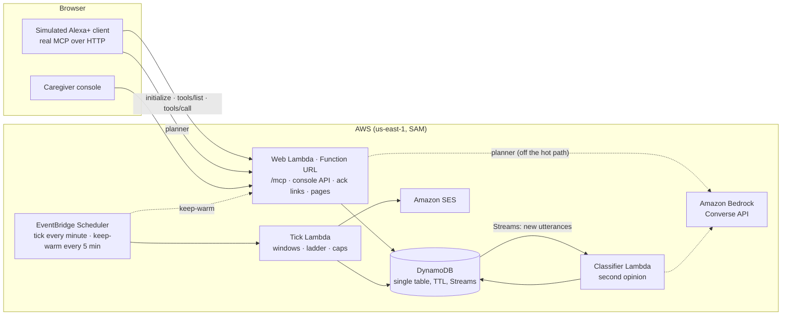

# Closed Loop

**Daily check-ins that close the loop.** A self-hosted MCP server for an Alexa+ add-on that asks an older adult who lives alone a few check-in questions their family wrote, records the answers honestly, follows up later, and emails a family member only when a loop stays open.

> **Simulated client.** Simulated Alexa+ client. Not Amazon software. Alexa+ add-on tooling is partner-only, so this project implements the MCP server side and demonstrates it through a self-built MCP client, as the hackathon FAQ allows.
>
> **Scope.** Reminders and check-ins only. Not an emergency alert system. No answer does not mean an emergency.
>
> **Voice turns.** Check-in conversations are started by the person, a household routine, or the simulator. MCP add-ons have no documented way to speak first.

Demo video: _link added at submission_ · Live demo: _URL shared with judges (access code required)_

---

## What it does

A reminder that says "take care of your morning routine" never learns whether that happened. Families improvise around this (a reminder plus a follow-up call, or a lamp switched off as a sign of life). Amazon's own remote-caregiving service, Alexa Together, is no longer available (Amazon, May 2025). An estimated 7.4 million Americans 65 and older live with Alzheimer's, and 1 in 4 older Americans with dementia or mild cognitive impairment lives alone ([sources](docs/impact.md)). Closed Loop does the part that comes **after** the question:

1. **Record what was said, honestly.** "I think so, maybe after lunch" is stored as *said later*, never as done. A hedged "yes" becomes *said they would, not sure*. The ledger only ever says *reported by the person*, *said later*, *no response*, *needs human contact*, and never "confirmed".
2. **Follow up.** It asks again at the time the person chose ("after lunch" → 13:00), or after the caregiver's re-ask interval, at most a set number of times. It never re-asks in the same turn.
3. **Tell a human when the loop stays open.** When a window closes with no report, the family member gets a plain email: *"We did not hear back about your morning routine today. This is not an emergency alert."* One click acknowledges it and stops further emails. If nobody acknowledges for a second day, the second contact is told.
4. **Let family ask, never answer.** From their own Alexa, a family member asks "How is Mom doing today?" and hears the day exactly as recorded. A family member's linked account can never answer, defer, or pause a check-in for the person; the server refuses it.
5. **Let the person set their own safety net, by voice.** Margaret says *"If I haven't said good night by ten, let Dana know."* The assistant reads it back and asks first; nothing is set until Margaret says yes. It is never asked: the loop closes when Margaret says "good night" before 10 pm, so it needs no proactive prompt. If Margaret doesn't, Dana gets an email in Margaret's name: *"Margaret asked Closed Loop to let you know if Margaret hadn't said "good night" by 10 pm. Margaret hasn't yet. This is not an emergency alert."* Family see these in the console, marked *Set by Margaret*, and can pause everything, but cannot create, edit, or cancel them.

Confusion or distress ("I want to go home, where is everyone?") gets the family's own calming line, no further questions, and a neutral note to the family: *"Margaret seemed confused or upset during a check-in. A call may help."* Emergency wording gets one fixed line: *"If this is an emergency, please call 911 now."* Self-harm wording adds the 988 Suicide and Crisis Lifeline.

## Try it locally (no AWS account needed)

Requires Node.js 20 or later.

```bash
npm install
npm run dev
```

Then open:

- **Simulator:** http://localhost:5173/simulator/ (access code `local-dev`, filled in automatically locally)
- **Caregiver console:** http://localhost:5173/console/
- **MCP endpoint:** http://localhost:5173/mcp with header `Authorization: Bearer local-dev-mcp`

Local run mode uses an in-memory store, the same simulated clock, the rule-based planner, and a fake email sender that writes each email as an HTML file to `./out/emails/`.

### A two-minute walkthrough

1. In the simulator, press **Start a fresh demo day at 7:55 am**, then **+1 hour**.
2. Press **Simulate morning routine start**. The assistant asks Margaret's morning question, worded by her daughter.
3. Reply **"I think so, maybe after lunch"**. Watch the MCP traffic pane: the planner picks `defer_checkin`, and the browser calls the real MCP server. The card shows *said later · ask again at 13:00*.
4. Press **+5 hours**, then the routine button again. The follow-up comes first. Reply **"Yes, done."** The loop closes: *reported by the person*.
5. Press **+1 day**. Yesterday's unanswered lunch and evening windows close; an email to Dana appears in the Family email panel (and in `./out/emails/`). Open the console and press **I've been in touch** to acknowledge.
6. Try **"I want to go home. Where is everyone?"** and **"I fell and I can't get up."**
7. Press the chip **"If I haven't said good night by ten, let Dana know."** and answer **"Yes, please."** Then type **"Good night"**: the planner looks up Margaret's own check-ins (`get_my_status`), then closes the loop (`record_response`). Or skip the good night and press **+5 hours** until it is past 10 pm to see the email to Dana in Margaret's name.

### Check the MCP server with other clients

```bash
npx @modelcontextprotocol/inspector@2.11.0 --cli http://localhost:5173/mcp --transport http --header "Authorization: Bearer local-dev-mcp" --method tools/list
npm run second-client -- http://localhost:5173/mcp local-dev-mcp
spikes/handshake.sh http://localhost:5173 local-dev-mcp
```

## Architecture



- **MCP tool calls touch DynamoDB only.** No LLM and no network call on the hot path. Warm round trips measured 9 ms p50 / 33 ms p95 server-side (Alexa+ requires under 500 ms).
- **The tick cannot speak to anyone in the home.** It closes windows, decides who to tell, and sends email. Every alert is claimed with a conditional write before sending, so overlapping ticks never double-send.
- **The planner stands in for Alexa+'s own LLM.** The browser asks it which tool to call, then makes the MCP call itself, so the traffic you see is real. It uses Bedrock (Converse with the live `tools/list` as tool definitions) and falls back to rules, saying so in the traffic pane.
- **Results come with a card.** An MCP App (`ui://` resource) renders each result visually wherever the client supports MCP Apps.
- **A second opinion runs after the fact.** New utterances flow through DynamoDB Streams to a classifier that asks Bedrock to re-read them. It can only move a record toward caution: distress it hears escalates to *needs human contact*; a "done" it doubts gets flagged in the console.

More detail: [docs/architecture.md](docs/architecture.md).

## The MCP server

Self-hosted, **Streamable HTTP**, stateless (no `Mcp-Session-Id`), JSON responses, built on `@modelcontextprotocol/sdk` **1.32.1** (pinned to the 1.x line).

| Tool | Input | What it does |
|---|---|---|
| `get_due_checkins` | none | Open check-ins right now, in the family's wording. Marks them asked; re-serves follow-ups when due. |
| `record_response` | `occurrenceId`, `response` (`done` · `later` · `not_yet` · `no` · `unsure` · `needs_help`), `utterance` (≤200 chars, optional) | Runs the safety layer, stores what was said honestly, returns the wording to read back and the next step. |
| `defer_checkin` | `occurrenceId`, `until` (`in_30_min` · `in_1_hour` · `after_lunch` · `this_afternoon` · `this_evening`) | Moves the next ask to a concrete time inside the window. |
| `get_my_status` | none | Today in plain words, and who gets emailed, so the person knows what is shared. Lists the person's own check-ins (`mine`) with the occurrence that saying the phrase now would close. |
| `pause_checkins` | `scope` (`today` · `24_hours`) | Always honored, no questions asked. |
| `get_family_summary` | none | For a family member: today's check-ins in the exact recorded wording, by name, with "a call may help" when one needs human contact. Read-only. |
| `set_my_checkin` | first call: `phrase` (words only, ≤40), `by` (`HH:MM`), `tell` (contact name or relation), `repeat` (`tonight` · `daily`); second call: `confirmToken`, `utterance` | For the person only. The first call returns a spoken preview and a signed token valid for 5 minutes, and stores nothing. The second call creates the check-in only with that token and the person's own clear yes. |
| `cancel_my_checkin` | `phrase` or `checkinId` | For the person only. Cancels one of their own check-ins; its open window is marked *cancelled by the person* and nobody is emailed. |

Every tool returns `structuredContent` plus a short text fallback. Signatures are fixed, strings are bounded, choices are enums (Alexa+ refreshes tool definitions only on deployment).

**MCP App card.** The server also publishes `ui://closed-loop/checkin-card` (`text/html;profile=mcp-app`, the MCP Apps extension, SEP-1865): one self-contained card that renders any of the eight results (open loops, *recorded as…*, *ask again at 13:00*, today's summary, paused, the family's view of the day, and the person's own check-in being previewed, set, or cancelled). Tools reference it in their definitions (`_meta.ui.resourceUri`, as the MCP Apps spec places it) and in their results (`_meta.ui` with `resourceUri`, `invoking`, `invoked`, as Alexa+'s lifecycle docs show). The card makes no network requests, so it runs under the spec's restrictive default CSP. The simulator advertises `io.modelcontextprotocol/ui`, reads the resource, and renders the card in a sandboxed iframe through the `ui/initialize` → `tool-input` → `tool-result` handshake. (Simplification: one sandboxed frame with an opaque origin, rather than the spec's two-level sandbox proxy on a separate origin.) Clients without UI support simply read the text.

**Protocol behaviors, tested** (`spikes/handshake.sh`, `test/mcp-protocol.test.ts`):

- `initialize` accepts both `2025-03-26` (Alexa's documented lifecycle example) and `2025-11-25` (the version its overview links), and answers with the one the client asked for.
- `Origin` is validated: same origin and listed origins allowed, requests with no Origin allowed, anything else **403**.
- No or wrong bearer token → **401** with **no** `WWW-Authenticate` header (Alexa+'s authentication page lists that header as not supported). Discovery is served at `/.well-known/oauth-protected-resource` (RFC 9728) and `/.well-known/oauth-authorization-server`.
- `GET /mcp` → 405. Oversize input and enum violations are rejected. `tools/list` is byte-identical across calls and protocol versions (snapshot test).
- A missing or partial `Accept` header is completed before the SDK sees it (the SDK returns 406 otherwise; Alexa's client headers are undocumented).

**Account linking (OAuth 2.1), as the Alexa+ add-on docs describe it:**

- **Authorization code + PKCE** for user-level access (`mcp:tools`, `mcp:resources`). `S256` is required, `resource` must be this server's `/mcp` URI, redirect URIs are matched exactly, and the response carries `iss`. To link, the person enters a one-time **link code** that the family creates in the caregiver console (8 characters, single use, 10 minutes, stored only as a hash).
- **Two roles.** The console creates a link code either for the person's own Alexa or for a family member's. The role rides in the authorization code, the refresh token and the access token (`role: family`); family tokens get a tool error from every tool that answers, defers or pauses a check-in, or sets up or cancels one of the person's own, and can call `get_family_summary`.
- **Client credentials** for service-level access (`mcp:service`): it can `initialize` and list tools, but a tool call gets Alexa's documented `401 {"error":"unauthorized","message":"Access token required to use this tool."}`. No refresh token is issued.
- **Tokens:** JWT access tokens (HS256, at most 3600 s, audience = the `/mcp` URI) and a rotating refresh token with every user access token; refresh tokens can be revoked (RFC 7009) or unlinked from the console. Static client registration (Alexa+ does not support DCR); clients authenticate with HTTP Basic or POST-body credentials.
- **Two clients are registered:** `alexa-plus` (confidential; redirect URIs from `alexa-ai configure-account-linking` go in `ALEXA_REDIRECT_URIS`) and `simulator` (public, PKCE only, same-origin redirect). The simulator's **Link with OAuth 2.1** button runs the full flow and then uses the OAuth token for its MCP calls. The static demo bearer token still works for MCP Inspector and scripts.

## Agent Skill

[`skills/closed-loop-checkins/SKILL.md`](skills/closed-loop-checkins/SKILL.md) packages the check-in protocol for any agent connected to the server: how to map replies to responses (hedges are `unsure`, never `done`), what to do with a calming line or the 911 line, the words never to use, and how to answer a family member. With Claude Code: `claude mcp add --transport http closed-loop <url>/mcp --header "Authorization: Bearer $MCP_BEARER_TOKEN"`, then copy the folder to `~/.claude/skills/`.

## Safety and honesty, by design

- **Rule-based safety layer on the hot path** (no LLM): hedges ("I think so", "maybe", "just about to") turn `done` into `unsure`; anything without clear affirmative wording fails closed to `unsure`, never `done`. A 265-reply eval assumes the worst case (the planner claims `done` for everything) and counts both directions: 0 unsafe misses (nothing recorded as done that was not said, no weaker reply than the words call for) and 0 false alarms. Its first run, on 225 replies, found 44 failures; the rules were fixed and the cases kept ([docs/evals.md](docs/evals.md)).
- **Distress branch:** calming line only, no re-quiz, and no check-ins asked for 60 minutes. With no check-in in progress, the family is still told (the note says it happened outside a check-in), and a calming line that promises a call is said only when a note goes to someone. **Crisis branch** (explicit emergencies: a fall, can't breathe, chest pain, bleeding): fixed 911 line (plus 988 for self-harm wording), with no promise that anyone is told immediately. A bare "Help!" gets the calming line and the 911 line; "help me with the remote" raises no alarm.
- **The ledger never claims more than happened.** "No response" says whether the person was ever asked: *no response (not reached)* versus *no response (asked, no answer)*.
- **The person's own check-ins:** two calls, so a model cannot create one in a single unconfirmed call (a spoken preview with an HMAC-signed token bound to the household and the exact draft, then the person's own words, which must be a clear yes). The same lint, consent gate, quiet hours, daily email cap, and pause apply; at most 3 at a time; the contact must already be on the email ladder. Only the person's own phrase closes one (a different phrase, no words, or "I haven't said good night" fails closed), and a crisis said while setting one up still gets the 911 line.
- **Caregiver wording lint:** check-in text is read aloud, so drug names, doses, URLs, and long text are rejected with plain advice ("Use generic wording like 'your morning routine'").
- **Consent and control:** check-ins run only with a recorded consent that names the person and who recorded it. Revoking it stops questions and emails immediately. Plans expire (default 14 days) so a forgotten plan cannot keep emailing. At most 3 emails per day; quiet hours hold emails overnight. The person can pause any time.
- **Data minimization:** utterances are cut to 200 characters and expire after 30 days (DynamoDB TTL); a delete-all-data button removes everything.
- **Acknowledge links are signed and expire.** Opening one only shows a button, so email link scanners cannot acknowledge on someone's behalf.

## Accessibility

The console follows Amazon product-UI conventions with Apple's system type (see [DESIGN.md](DESIGN.md)): full keyboard use, visible focus, labelled controls, errors tied to their fields, and status that never relies on color alone (each check-in's ring changes shape: open, closed, dotted, or marked, always next to the recorded words). axe-core reports **zero violations** on all five pages (landing, console, simulator, sign-in, acknowledge) in light and dark themes ([docs/accessibility.md](docs/accessibility.md)). This is a design choice; it is not a claim that blind or low-vision users asked for this product.

## Deploy to AWS

Requires the AWS CLI, AWS SAM CLI, and a verified SES identity (the SES sandbox only sends to verified addresses).

```bash
cp .env.example .env    # fill in tokens, SES addresses, optional Bedrock model ID
npm run deploy          # builds the Lambdas with esbuild and runs sam deploy
```

The stack creates one DynamoDB table (on-demand, TTL, Streams), three arm64 Lambda functions (web, tick, classifier), two EventBridge Scheduler schedules, least-privilege IAM for SES and Bedrock, and 7-day log retention. It stays inside the free tier for a demo. Run the end-to-end check against it:

```bash
npm run e2e -- https://<function-url-id>.lambda-url.us-east-1.on.aws "$ADMIN_TOKEN" "$MCP_BEARER_TOKEN"
```

## Tests

```bash
npm test            # 412 tests: state machine, ladder, the person's own check-ins, 265-reply safety eval, stores, MCP protocol, OAuth, planner, console API, classifier
npm run typecheck
npm run e2e         # replays the demo against a running deployment and checks the ledger
```

Set `DDB_TEST_TABLE` to run the store contract tests against a real DynamoDB table as well. The eval and its results are in [docs/evals.md](docs/evals.md); each Alexa+ requirement is mapped to the test that proves it in [docs/alexa-plus-readiness.md](docs/alexa-plus-readiness.md).

## Known limits (stated plainly)

- **"Good night" reaching the add-on is unverified.** The person's own check-ins close when the person speaks first, but whether Alexa+ routes a bare phrase like "good night" to an add-on, rather than answering it itself, is not documented (FRICTION_LOG #14). In the simulator, what Margaret types goes to the add-on.
- **No proactive speech.** No documented way exists for an MCP add-on to start a conversation, set a native reminder, or be invoked by a routine. That is the single most important missing primitive for this use case (see [FRICTION_LOG.md](FRICTION_LOG.md) #4 and the feature request in [PRODUCT_FEEDBACK.md](PRODUCT_FEEDBACK.md)).
- **Not tested against real Alexa+.** Add-on tooling is partner-only. The server follows Alexa's published requirements and is exercised by three different MCP clients.
- **Bedrock on this account.** The new AWS account used for the hackathon has a Bedrock daily token quota of 0 (FRICTION_LOG #7). The Bedrock planner and classifier are wired, deployed, and pass Bedrock's request validation; until the quota is raised they fall back to rules and say so.
- **Auth.** OAuth 2.1 account linking is implemented and tested against the published Alexa+ requirements, but not against Alexa's real linking service (partner-only). Access tokens are self-contained JWTs, so unlinking stops refreshes immediately and existing access ends within an hour.
- **Cold starts** of the full web function are about 0.9 s (0.61 s init plus a first request that creates the day's records); warm calls take 4–28 ms server-side. A keep-warm schedule keeps one instance ready because new accounts cannot use provisioned concurrency (FRICTION_LOG #8).

## Repository layout

```
packages/core/          state machine, ledger wording, safety rules, lint, clock, stores (pure TS, tested)
packages/mcp-server/    MCP handler on SDK 1.x, eight tools, auth, Origin, OAuth metadata, adapters
packages/api/           console API, ack links, admin clock, planners, web + Lambda entry
packages/tick/          tick Lambda, SES and file mailers
packages/classifier/    DynamoDB Streams second-opinion Lambda
packages/store-dynamo/  DynamoDB implementation of the store
apps/                   simulator, console, landing page (static, no build step)
infra/template.yaml     AWS SAM
scripts/                dev server, build, deploy, e2e replay, second MCP client
spikes/                 Phase 0 handshake and latency spikes
test/                   unit, protocol, and contract tests
docs/                   architecture, demo script, accessibility
```

## Related

[mcp-handshake-check](https://github.com/Juiccef/mcp-handshake-check): the zero-dependency checker built alongside this project, which runs the same wire-level checks against any stateless Streamable HTTP MCP server.

## License

[MIT](LICENSE)
